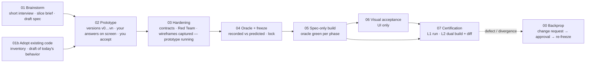

# Spec-Driven Development Skills

> **Code is a byproduct of the spec — never the other way around.**

This repository holds the **Spec-Driven Development (SDD)** pipeline for AI coding agents: a gated workflow that takes an idea to a frozen specification complete enough that two independent agents, given only that specification, build systems an executable oracle cannot tell apart — and that checks the claim instead of asserting it.

**Current release:** ICM workspace template `2026.10.21-v3.5-prototype-first`. Everything else in this repository is either a companion skill that works on a template-built spec set, or the legacy v2 skills kept for projects that still run them.

| Part | What it is | Status |
|---|---|---|
| [`icm-workspace-template/`](./icm-workspace-template/) | The pipeline itself: stage contracts, zero-dependency tools (`sdd.cjs`, `oracle.cjs`, `ui-capture.cjs`, `ui-specgen.cjs`), the Equivalence Profile, schemas, templates and a validated reference example. Copied into each project; the project records and locks the exact version it was built with. | **Maintained — the single source of the pipeline** |
| [`design-package/`](./design-package/) | Skill that derives a systems-engineering design package from a template-built spec set, with a review loop back into the spec. | Maintained |
| [`spec-deliverables/`](./spec-deliverables/) | Skill that derives the API reference, the user manual and the test plan from a template-built spec set, as markdown plus one self-contained HTML page each, stamped with the lock. | Maintained |
| `brainstorming/`, `sdd-adoption/`, `adversarial-swarm-analysis/`, `interactive-wireframing/`, `writing-implementation-phases/`, `development-swarm/`, `spec-driven-development/`, `shared/` | The v2 pipeline as global agent skills (release `2026.09.28-v2`). | **Legacy** — kept for projects that still use them; not maintained against v3 (no oracle, lock, prototype stage or gated transitions there) |
| `verification-before-completion/`, `visual-acceptance-testing/`, `ubiquitous-language/`, `frontend-ui-design/`, `test-driven-development/`, `kubernetes-deployment/`, `interpretable-context-methodology/` | General-purpose skills that do not depend on the pipeline version. | Usable with either |

## Quick start (the template)

1. Copy the template into your project root and open it in your agent (Claude Code, Codex, Cursor, Gemini, …):
   ```bash
   cp -r /path/to/skills/icm-workspace-template/{.cursorrules,CLAUDE.md,AGENTS.md,specs} /path/to/your-project/
   ```
   The three entry files are identical copies of `specs/.sdd/_config/entrypoint.md`; if your project already has one, append that file's content to it. Node.js ≥ 18 is the only requirement (Playwright for UI projects).
2. Ask the agent to start. It reads its entry file, runs `node specs/.sdd/scripts/sdd.cjs status`, and begins Stage 01 for a new product or Stage 01b for an existing codebase.
3. What you will experience: a short interview (one question per message, within a budget), one slice brief to OK, and a **running prototype** to try and accept — before any contract, oracle case or wireframe is written. Hardening, the oracle and the freeze follow, against the running prototype. `node specs/.sdd/scripts/sdd.cjs readiness` tells you at any time what is left and what the next action is that is yours, and `sdd.cjs dashboard` renders the same as a page (`specs/logs/dashboard.html`, rewritten at every transition).

Already on an older template version? `node <new-template>/specs/.sdd/scripts/sdd.cjs upgrade --from <new-template> --root <your-project>` swaps the pipeline files, keeps your state, renames legacy logs, regenerates the entry files and writes `specs/logs/upgrade-<version>.md`.

The template's [README](./icm-workspace-template/README.md) is the full reference: the equivalence definition and its two certification levels, every stage and its exit gate, the tooling, change classes, the operating playbook and the release history (`icm-workspace-template/Future_work.md`).

## The pipeline in one picture

See it, then harden it. The running prototype is the boundary between what the user is asked to define up front (little) and what the pipeline pins down afterwards (everything).



| Stage | Who | Produces |
|---|---|---|
| 01 Brainstorm | you + agent (≤ 12 questions, one brief to OK) | `SPEC.md` draft, decision log, gap register with provisional answers, design tokens (UI) |
| 01b Adoption | agent + you (same budget) | The same, written from what the code does today, plus a slicing plan |
| 02 Prototype | you (demos) + agent (builds) | A working slice, one version row per demo, your acceptance recorded by the tool |
| 03 Hardening | agent, prototype running; you answer batched policy questions | Machine contracts, a complete spec, Red Team rulings, captured wireframes (UI) |
| 04 Oracle + freeze | agent; you approve the freeze | Oracle cases derived from the spec (two interpretations, zero disagreements), phases, `spec.lock.json` |
| 05 Build | agent, spec-only | Build A continues the prototype; build B (for L2) starts from the frozen set alone |
| 06 Visual acceptance | agent (UI only) | Screens graded against tokens, wireframes and frozen UI specs |
| 07 Certification | agent reports to you | `EQUIVALENCE_REPORT.md`: L1 (oracle green on the lock) or L2 (two builds, zero divergences) |
| 00 Backprop | agent proposes, you approve | Spec Change Request, re-freeze; never a code patch |

## What a finished spec set contains

Everything lives in the project's `specs/` directory. The **frozen set** is hashed into `specs/spec.lock.json` at the end of Stage 04 and changes only through the pipeline's own doors.

| Artifact | Holds | Frozen |
|---|---|---|
| `SPEC.md` (+ `spec/<module>.md`) | The rules, in a fixed 14-section structure; invariants as `Vn`; the Equivalence Boundary (what may vary between builds) | yes |
| `contracts/` | `openapi.yaml`, `schema.sql`, `statecharts.json`, `errors.json`, `manifest.json`, … — machine-checked by `sdd.cjs check` | yes |
| `fixtures/` | The oracle: cases every build is graded by, each expected value cited from the spec; frozen UI specs | yes |
| `wireframes/` | Screen states captured from the accepted prototype (UI) | yes |
| `DESIGN.md` | Design tokens and the UI State Matrix | yes |
| `DECISION_LOG.md` | Every decision with its options and rationale; append-only, fingerprinted at each transition | no |
| `GAPS.md` | Open questions with provisional answers, deferred features, uncited prototype decisions | no |
| `IMPLEMENTATION_PHASES.md`, `changes/SCR-*.md`, `backprop-log.md`, `logs/` | Phases bound to oracle runs, Spec Change Requests and their defect traces, interview / prototype / Red Team / oracle logs, stage transitions with metrics | no |

## Derived artifacts

A spec set this complete can generate the deliverables of a traditional process mechanically. The [`design-package`](./design-package/) skill is the first: a systems-engineering package ("shall" requirements traced to decisions and invariants, design decision records, architecture and behavior views, an interface control table, change control from the lock and change requests, verification status from the oracle runs, the UI baseline from the wireframes) with permanent ids, numbered revisions, impact analysis, and a review loop that turns a reviewer's comments into change requests to the spec — never into package edits. The [`spec-deliverables`](./spec-deliverables/) skill adds the three reader-facing documents, fully mechanical: the **API reference** (every operation with its rules, parameters, every declared outcome and a recorded request/response pair from the oracle), the **user manual** (every approved screen with its embedded wireframe, states and strings; roles, concepts, messages, errors, configuration) and the **test plan** (traceability from invariants and operations to cases, every procedure, the schedule by phase, the latest results bound to the lock). `deliver.cjs check` says when any of them is older than the spec set.

## Repository layout

```
skills/
├── icm-workspace-template/        # THE PIPELINE (v3.5). Copy into a project. README = full reference.
│   ├── specs/.sdd/                #   stage contracts, tools, Equivalence Profile, schemas, templates, example
│   ├── tests/                     #   state-machine tests (node --test tests/*.test.cjs)
│   └── Future_work.md             #   release history and open items
├── design-package/                # Companion skill: SE design package derived from a spec set
├── spec-deliverables/             # Companion skill: API reference, user manual, test plan derived from a spec set
├── scripts/validate-icm-sync.sh   # Compares the legacy v2 skills with the template stages (historical)
├── shared/                        # Legacy v2 shared templates (the template carries its own under _config/)
├── brainstorming/ sdd-adoption/ adversarial-swarm-analysis/ interactive-wireframing/
│   writing-implementation-phases/ development-swarm/ spec-driven-development/   # Legacy v2 pipeline skills
├── verification-before-completion/ visual-acceptance-testing/ ubiquitous-language/
│   frontend-ui-design/ test-driven-development/ kubernetes-deployment/
│   interpretable-context-methodology/                                            # General-purpose skills
└── sdd-icm-documentation.html     # Visual guide to the pipeline and the ICM idea (open in a browser)
```

## Why a template instead of global skills

Global agent skills live outside the project: they are not portable (a teammate needs the same setup), not auditable (the instructions that shaped the code are invisible to review) and not versioned (a project cannot say which pipeline built it). The Interpretable Context Methodology (ICM, [paper](https://arxiv.org/html/2603.16021)) moves the orchestration into the project's own files: a routing document, one contract per stage, reference material loaded on demand, and the working artifacts. The pipeline files are part of the frozen set, so every project records and locks the exact version it was built with, and `sdd.cjs upgrade` moves it to a newer one deliberately.

Stage contracts use a compact notation (`!` = must, `⊥` = never, `∀` = for all, `∃` = exists, `→` = becomes) with a decoder line at the top of each file, so an agent reads about 80 lines to route and one stage contract to work.

## Companion and general-purpose skills

| Skill | Purpose |
|---|---|
| [`design-package`](./design-package/) | Systems-engineering design package derived from a spec set; impact analysis per revision; review comments become change requests (see above) |
| [`spec-deliverables`](./spec-deliverables/) | API reference, user manual and test plan derived from a spec set; `build`, `compile` to HTML, `check` for staleness against the lock (see above) |
| [`verification-before-completion`](./verification-before-completion/) | Evidence before claims: run the command, read the output, then say it passes |
| [`visual-acceptance-testing`](./visual-acceptance-testing/) | Browser-based visual QA: screen walk, interaction audit, token verification, debug-artifact scan (the template's Stage 06 is its pipeline form) |
| [`ubiquitous-language`](./ubiquitous-language/) | Domain glossary: canonical terms, flagged ambiguities, consistent naming across specs |
| [`interpretable-context-methodology`](./interpretable-context-methodology/) | How to work in any ICM-structured workspace (routing document, stage folders, contracts) |
| [`frontend-ui-design`](./frontend-ui-design/), [`test-driven-development`](./test-driven-development/), [`kubernetes-deployment`](./kubernetes-deployment/) | Standalone engineering skills, independent of the pipeline |

Install a skill by copying its folder (with its `references/` and `scripts/` subfolders) to wherever your agent reads skills from: `~/.claude/skills/<name>/` for Claude Code, `~/.gemini/config/skills/<name>/` for Gemini Code Assist, or a project's `.claude/skills/` for a per-project skill (the `design-package` skill is used that way).

## Legacy: the v2 global skills

Release `2026.09.28-v2` delivered the pipeline as global skills orchestrated by `spec-driven-development` (with `sdd-adoption` for existing codebases), with `shared/` templates and a user-rule snippet that forced the governor on every request. Those files are unchanged and still work for projects started with them, but the v3 pipeline exists only in the template: the oracle, the lock, the Equivalence Profile, the prototype stage, gated transitions and the measured L2 certification have no counterpart in the skills. New projects should start from the template; a v2 project can be brought over with Stage 01b (adoption), using its existing `SPEC.md` as evidence of intent.

To keep using the v2 skills, copy the pipeline skill folders and `shared/` to your agent's skill directory, resolve `{{SKILLS_DIR}}` in the copied markdown to that directory's absolute path, and add this to your agent's global instructions:

```
You MUST use the Spec-Driven Development skill (instructions located at
/path/to/skills/spec-driven-development/SKILL.md) EVERY TIME there is a
request for a new feature, update, or bugfix in a project that contains
a specs/ folder. Never write code before updating the spec.
```

`scripts/validate-icm-sync.sh` compares the legacy skills with the template's stage contracts; it reports drift rather than preventing it and is kept for anyone comparing the two.

## Recommended: Context7 MCP server

Stage 05 builders (and the legacy `development-swarm`) query the latest framework documentation through [Context7](https://context7.com) when it is available, and note "docs not verified" in their logs when it is not. The pipeline works without it; generated code may lag recent API changes.
