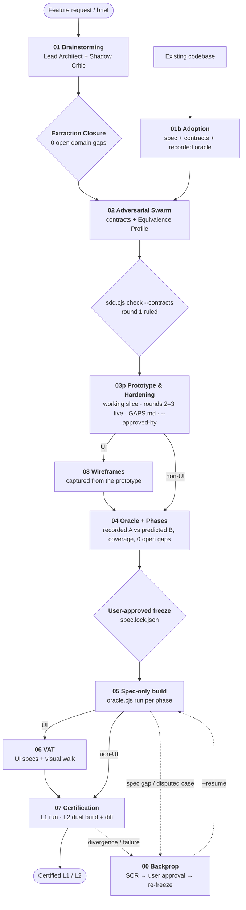

# SDD ICM Workspace Template

> **Release Version:** `2026.10.18-v3.1-prototype-first` (Updated October 18, 2026)

A portable, agent-agnostic workspace template that enforces the **Spec-Driven Development (SDD)** pipeline through filesystem structure and a small set of zero-dependency tools, so that independent coding agents built from the same spec produce **observationally equivalent** systems — and so that claim can be checked.

Based on the [Interpretable Context Methodology (ICM)](https://arxiv.org/html/2603.16021) paper's principle: _"If the context is interpretable, the agent is steerable."_

## Quick Start

1. **Copy** the template contents into your project root:
   ```bash
   cp -r /path/to/skills/icm-workspace-template/{.cursorrules,CLAUDE.md,AGENTS.md,specs} /path/to/your-project/
   ```
   `CLAUDE.md`, `AGENTS.md` and `.cursorrules` are identical copies of `specs/.sdd/_config/entrypoint.md`. If your project already has one of these files, append the entrypoint's content instead of overwriting it.

2. **Requirements:** Node.js ≥ 18 for the tools (`specs/.sdd/scripts/*.cjs`, no `npm install`). Playwright only for UI projects.

3. **Open** the project in your AI-assisted editor (Claude Code, Codex, Cursor, Gemini, …) and ask your agent to start. It reads its entry file, runs `node specs/.sdd/scripts/sdd.cjs status`, and begins at Stage 01 (or 01b for an existing codebase).

No global rules. No plugin install.

## The Core Mission: Observational Equivalence

The fundamental failure mode of AI-assisted engineering is **the ambiguity gap**: a prose specification leaves choices open — error formats, null vs absent fields, ordering, rounding, which error wins when two apply — and two independent agents (or two runs of one agent) fill them differently. Both claim success; their systems are incompatible.

SDD v3 defines equivalence operationally:

> **Two builds are observationally equivalent iff, for every case and probe in `specs/fixtures/`, they produce identical observations at the declared interfaces, after masking only the values the spec explicitly declares variable** (SPEC §9 Equivalence Boundary: server-generated ids, timestamps, cursor values, free-text error details).

Equivalence is therefore relative to the oracle and its probes — the stronger the oracle, the stronger the claim — and it is *measured*:

| Level | Evidence |
|---|---|
| **L1 Oracle-conformant** | Frozen set intact + `oracle.cjs run` 100% green against the current lock |
| **L2 Equivalence-verified** (default target) | L1 + a second build made from the frozen set alone, in a fresh agent session, and `oracle.cjs diff` (and `diff-ui` for UIs) reporting zero divergences between the two |

Every divergence `diff` finds is an unconstrained degree of freedom the spec forgot to pin. It goes back into the spec (Stage 00), not into the code.

### Diff early: measuring divergence before code exists

Most divergences start as ambiguous spec text, so v3 measures them at every stage, cheapest first:

| Stage | Diff | Catches |
|---|---|---|
| 01 | Two fresh agents predict outcomes of 3–5 scenarios per topic, with citations — once per slice, plus right after lifecycle, permission and money topics | Business-policy gaps → next interview question |
| 02 | Round 1 of the Red Team over contracts + prose: only a concrete fork (one request, two legitimate observations) blocks | Contract and plumbing ambiguity, before any code |
| 03p | Prototype Decision Inventory (every observable choice cites the spec or becomes a `GAPS.md` row); rounds 2–3 with an **executed** Fork Test against the running prototype; sampled `diff-expect` by two spec-only authors (≥ one case per operation/command, gated) | Gaps a real builder hits, while the user watches the product |
| 04 | Two interpretations: A recorded from the accepted prototype, B predicted from the spec alone, `diff-expect` (gated); profile-generic cases generated, not hand-written; `gen-probes` widens the measured surface | Remaining ambiguity; places where the prototype decided what the spec did not |
| 05 | Builder's decision inventory per phase; optional lockstep build B with `diff --phase N` | Gaps while little code depends on them |
| 07 | Full dual-build `diff` / `diff-ui` (gated for L2; per slice, or per release with `equivalenceCadence: "release"`) | The evidence |

A predicting author writes `{"$unspecified": "…"}` where the spec does not decide a value; agreement without citations counts as a gap, because two identical guesses are still guesses. A value backed only by a `recorded:` citation ("the prototype did it") is also a gap.

### See it first, then harden it

The pipeline used to make the user wait for a frozen oracle before seeing anything run. Now:

- **Stage 01 scopes a slice** — a bounded first increment (30–80 observable outcomes is a good first slice; the cap is 150, `manifest.json#sliceCap`). Everything else is a `deferred` row in `specs/GAPS.md`, and the next slice starts from those rows.
- **Stage 02 is one round** — contracts plus a single full Red Team pass. Only findings with a concrete fork (one request, two legitimate observations) block; everything else is advisory backlog. Rulings go in a ledger so settled items are not re-litigated.
- **Stage 03p builds a working prototype** of the slice for the user, right after that round — every project type. Feedback edits the spec in the same step; uncited prototype decisions become `GAPS.md` rows. Then hardening rounds 2–3 run **with the prototype running**: the Fork Tester sends the request instead of imagining the answer, the Reconciler reads real code. Hard cap 3 rounds per slice; leftovers go to the user as questions, not to a round 4. The stage ends when the user accepts on the command line (`transition --completed 03p --approved-by "<user>"`, recorded in `transitions.jsonl`, never typed into a file by the agent), and the prototype becomes build A.
- **UI projects capture their wireframes from the prototype** (Stage 03, after 03p): each screen state is saved as static HTML with its test ids, copy and tokens verified. Build B never sees the prototype, so every layout decision it made is either frozen in a wireframe or caught as a gap.
- **`sdd.cjs readiness`** reports — in counts, never a score — how far the slice is from a freezable spec: open gaps by kind, coverage, latest `diff-expect`, failing gates.
- **Stage 04 records instead of re-deriving** — build A's observations are recorded, an independent spec-only author predicts them, and `diff-expect` turns every disagreement into a spec fix. Stage 04 refuses to finish while any gap is `open`.
- **Stage 05 loops on the oracle, per phase** — Decision Inventory, build, `oracle.cjs run --phase N` until green, then one Red Team pass for what the oracle cannot see. No per-file attack loop before the oracle has spoken.
- **Iterations keep the old oracle as a guard** — on the next slice, Stage 03p prototypes on the certified build A, and every existing case must stay green unless a decision-log entry names it as a declared behavior change.
- **L2 cadence is a choice** — `manifest.json#equivalenceCadence: "release"` lets intermediate slices certify L1 with an explicit `L2 pending` row and a lockstep diff as early warning; L2 is certified with `transition --completed 07 --release` before a release. The default stays L2 on every slice.

The guarantee is unchanged: L2 still requires a build B made from the frozen set alone, an L1 certificate on a prototype-derived build says so, and a pending slice is never called L2.

### Reference example

[`specs/.sdd/_config/examples/notes-service/`](specs/.sdd/_config/examples/notes-service/) is a complete frozen spec set — SPEC, decision log, contracts, 55 derived cases plus 100 generated probes — validated against an independent reference implementation (55/55 green, zero divergences between two instances over all 155 cases, and every deliberately broken variant caught). Agents imitate examples more reliably than they follow rules.

**Contracts parse the same everywhere.** OpenAPI YAML is always read by the bundled `yaml-lite` parser, which rejects plain scalars that YAML 1.1 and 1.2 tools read differently (`yes`/`no`/`on`/`off`, `1_000`, `0755`, unquoted dates) — quote them — so the contract means the same thing to the tools and to every builder's YAML library.

### The Six Laws of SDD v3

1. **Zero unconstrained degrees of freedom — outside a declared boundary.** Every business decision is made with the user in Stages 01–02. What may legitimately vary is listed explicitly (SPEC §9); everything else is pinned.
2. **Pinned defaults for plumbing.** The [Equivalence Profile](specs/.sdd/_config/references/systems-standards.md) fixes the choices where builders typically diverge — error envelope (RFC 9457), status codes and error precedence, timestamps, ids, null handling, pagination, idempotency, concurrency, string normalization. Deviations are explicit overrides tied to a decision-log entry.
3. **Machine contracts over prose — and machine-checked.** Operations, storage, lifecycles and errors live in `specs/contracts/`; `sdd.cjs check` validates them against [JSON Schemas](specs/.sdd/_config/schemas/) and each other.
4. **One grader, never the builder.** The oracle is data (`specs/fixtures/`), written in Stage 04 before the graded build, and executed by the shipped, implementation-agnostic `oracle.cjs`. No stage writes its own grader. Expected values must be *derivable* from the spec (`derivedFrom`); a value the oracle author had to invent — or could only copy from the prototype — is a spec gap.
5. **The spec is the only channel.** The Stage 03p prototype is the only pre-freeze code and is never evidence. Stage 05 builders use only the frozen set — no conversation history, no swarm logs, no other implementation (build A may read its own prototype code; build B never sees it). Whatever they would have to guess is raised as a spec gap instead.
6. **Change control with a lock.** `sdd.cjs freeze` hashes the frozen set into `specs/spec.lock.json` after user approval. After that, frozen files change only through a Class 1 iteration or a Stage 00 Spec Change Request, each ending in a user-approved re-freeze. `sdd.cjs verify` detects anything else, and gates refuse to advance on a broken lock.

## Tooling

All tools are zero-dependency Node.js scripts in `specs/.sdd/scripts/`.

| Command | Purpose |
|---|---|
| `sdd.cjs status` | Current stage, lock state, latest evidence, and the next stage's exit gates |
| `sdd.cjs check [--contracts]` | Validate manifest, contracts, oracle cases, cross-references, coverage (every operation × status, transition, illegal transition, invariant, error code) and phase binding |
| `sdd.cjs readiness` | Report only (exit 0): slice size vs cap, gaps by kind (open and deferred), swarm rounds, coverage, latest diff-expect, failing gates for 02/03p/03/04 |
| `sdd.cjs freeze --reason R --approved-by U` | Lock the frozen set (refused unless `check` passes) |
| `sdd.cjs verify` | Exit 1 if any frozen file changed since the last freeze |
| `sdd.cjs transition --completed <stage> [--approved-by U] [--release]` | Record a completed stage — refused if out of order (unless `--override DECnnn`) or until that stage's exit gates pass. 03p requires `--approved-by` (the user's acceptance); 07 with cadence `release` requires `--release` to certify L2 |
| `sdd.cjs export <dir> [--update]` | Copy only the frozen set into `<dir>` for an independent (L2) build; `--update` resyncs it after a re-freeze, keeping B's code and progress |
| `oracle.cjs run [--phase N]` | Grade a build: HTTP, SQL and CLI steps with matchers, captures and templates |
| `oracle.cjs diff --a a --b b` | Run the same cases and probes against two builds; report every undeclared difference |
| `oracle.cjs diff-ui --a A.jsonl --b B.jsonl --b-root DIR` | Compare two builds' UI observations (ARIA snapshots + test ids from `ui-observe.cjs`) |
| `oracle.cjs gen-probes` | Derive edge-case probes from the OpenAPI contract (boundaries, nulls, Unicode, content types, idempotency, preconditions, pagination, routing) |
| `oracle.cjs diff-expect --a A --b B` | Interpretation diff: compare two independently written expectation sets; every disagreement, `$unspecified` or uncited case is a spec gap |
| `oracle.cjs strip-expect --from A --out DIR` | Request-only skeletons with neutral titles for an independent second author |
| `oracle.cjs env` | Print the frozen build environment every graded build is started with |
| `oracle.cjs record --target T --out F` | Fill expectations from observed behavior: characterize an existing system (Stage 01b) or record interpretation A from the accepted prototype (Stage 04) |
| `start-server.sh` / `stop-server.sh` | Visual Companion for brainstorming and live wireframes |

## Why ICM?

### The Problem with Global Skills

Traditional AI agent workflows rely on global configuration (`~/.gemini/config/skills/`, global `CLAUDE.md` rules, editor-specific rule files). This creates three problems:

1. **Not portable.** Share a project with a teammate? They need your exact skill setup.
2. **Not auditable.** The instructions controlling code generation live outside the repo — invisible to code review.
3. **Not versioned.** Skills evolve, but deployed projects don't track which version they were built with.

### The ICM Solution

ICM moves the orchestration logic **into the project's filesystem**. The agent discovers the pipeline by reading `WORKSPACE_ROUTING.md`; each stage's `CONTEXT.md` is a self-contained contract declaring Inputs, Process, Outputs and exit gates. The pipeline files are themselves part of the frozen set, so a project records — and locks — the exact pipeline version it was built with.

| Layer | What it does | Where it lives |
|-------|-------------|----------------|
| **Layer 0: Identity** | Workspace and pipeline version | HTML comments in `WORKSPACE_ROUTING.md` |
| **Layer 1: Routing** | Entry protocol, change classes, stage map | `WORKSPACE_ROUTING.md` |
| **Layer 2: Stage Contracts** | Detailed instructions per stage | `NN_stage_name/CONTEXT.md` |
| **Layer 3: Reference Material** | Profile, schemas, templates, checklists — loaded on demand | `_config/` |
| **Layer 4: Working Artifacts** | Spec, contracts, oracle, logs | `specs/` root |

**Token efficiency.** The agent reads `WORKSPACE_ROUTING.md` (~80 lines) to route, then only the relevant stage's `CONTEXT.md`; heavy references load only when a stage asks for them. Stage contracts use a compressed notation (`!` = must, `⊥` = forbidden, `∀` = for all, …) with a decoder line in each file.

## The Pipeline



| Stage | Purpose | Exit gate (`sdd.cjs transition`) |
|-------|---------|------|
| `00_backprop` | Classify defect → Spec Change Request → approval → patch spec/contracts/oracle → re-freeze | Lock intact, backprop log, `--resume` target |
| `01_brainstorming` | Socratic interview; slice scoped; all business policy for the slice extracted | SPEC, DECISION_LOG, (DESIGN), no placeholders |
| `01b_adoption` | Reverse-engineer an existing codebase; record a characterization oracle | Same as 01 |
| `02_adversarial_swarm_analysis` | Contracts + Red Team round 1 against the Equivalence Profile; fork-only blocking findings | `check --contracts`, slice ≤ cap, persisted round 1 + Outcome Table, rulings ledger with no open row |
| `03p_prototype` | Working prototype of the slice (every project type); feedback edits the spec; uncited decisions → GAPS.md; hardening rounds 2–3 against the running prototype; sampled diff-expect | `check --contracts`, run line, `--approved-by`, fresh decision inventory, valid GAPS.md, no open ruling, sampled diff-expect, (iterations) old oracle green or declared |
| `03_interactive_wireframing` | Wireframes captured from the accepted prototype: test ids, copy, tokens, states verified (UI only) | Wireframes + relative-linked DESIGN.md section |
| `04_writing_implementation_phases` | Oracle synthesis (recorded A vs predicted B), phases, user-approved freeze | Full `check`, zero open gaps, generated cases green on the prototype, lock intact |
| `05_development_swarm` | Spec-only build, per phase: inventory → build → oracle until green → one Red Team pass (A continues the prototype) | Lock intact, current unfiltered oracle run green, zero drift |
| `06_visual_acceptance_testing` | Frozen UI specs + visual walk (UI only) | VAT verdict PASS |
| `07_verification_before_completion` | Fresh evidence; L1/L2 certification; deferred gaps listed for the next slice | Fresh green run, equivalence report, (L2) zero-divergence diff — or `L2 pending` row under cadence `release` |

## Change Classes

| Class | Definition | Route |
|---|---|---|
| **0 Non-observable** | Refactor, dependency bump, performance, internal logging | 05 → 07; oracle must stay 100% green, lock unchanged |
| **1 Observable** | Feature, behavior change, new error, UI change, the next slice | 01 → 02 → 03p → (03) → 04 (re-freeze) → 05 → (06) → 07 |
| **2 Defect** | Disputed case, `diff` divergence, escaped bug | 00 → re-freeze → resume |

- **Adding a feature / next slice (Class 1):** Stage 01 starts from the `deferred` rows of `GAPS.md`; extend SPEC and contracts through Stages 01–02, prototype the change on build A in Stage 03p (the old oracle must stay green except for declared behavior changes), add cases and a new phase in Stage 04 (existing cases may only change where a decision-log entry declares the behavior change), re-freeze with approval, build the new phase. `--phase N` runs are cumulative, so old behavior keeps being re-graded.
- **Fixing a bug (Class 2):** Stage 00 decides whether the code broke the spec (→ Stage 05) or the spec allowed the bug (→ pin it, add a case that fails on the buggy build, re-freeze, → Stage 05).
- **Refactoring (Class 0):** no spec work at all — the frozen oracle proves the refactor changed nothing observable.

## Directory Structure

```
icm-workspace-template/
├── CLAUDE.md · AGENTS.md · .cursorrules   ← identical entry points (from _config/entrypoint.md)
├── README.md
└── specs/
    ├── .gitignore                          ← ignores Visual Companion sessions
    └── .sdd/                               ← pipeline machinery (frozen with the spec)
        ├── WORKSPACE_ROUTING.md
        ├── 00_backprop/ … 07_verification_before_completion/CONTEXT.md
        ├── scripts/                        ← sdd.cjs, oracle.cjs, sdd-lib.cjs, Visual Companion
        └── _config/
            ├── references/                 ← Equivalence Profile, oracle standard, checklists
            ├── schemas/                    ← JSON Schemas for manifest, errors, statecharts, oracle
            ├── contract-matrix.json        ← required contracts per project type
            ├── canonical-errors.json       ← profile error codes (machine-checked)
            ├── spec-template.md · design-template.md · gaps-template.md · rulings-template.md · prototype-record-template.md · …
            └── sdd-state.json.template
```

After running the pipeline, a project also has:

```
specs/
├── SPEC.md                    ← hardened spec (spec-template.md structure)      [frozen]
├── DESIGN.md                  ← design tokens (UI)                               [frozen]
├── contracts/                 ← manifest.json, openapi.yaml, schema.sql, statecharts.json, errors.json, …   [frozen]
├── fixtures/                  ← oracle.config.json, cases/*.json, seed/, ui/*.spec.ts   [frozen]
├── wireframes/                ← approved HTML wireframes (UI)                    [frozen]
├── spec.lock.json             ← lock manifest (hashes, approvals, history)
├── DECISION_LOG.md · IMPLEMENTATION_PHASES.md · GAPS.md · backprop-log.md
├── changes/SCR-*.md           ← Spec Change Requests
├── logs/                      ← swarm logs, oracle/diff reports, transitions.jsonl, VAT screenshots
├── dev-swarm-reconciliation.md · VAT_REPORT.md · EQUIVALENCE_REPORT.md
└── .sdd/_config/sdd-state.json ← pipeline pointer (written by `sdd.cjs transition`)
```

`sdd-state.json` keeps the five fields the SDD VS Code extension reads (`lastCompletedStep`, `stepName`, `projectType`, `timestamp`, `notes`); everything else lives in the lock and logs. 03p and 03 share step 3 (`stepName` and `specs/logs/transitions.jsonl` tell them apart; the user's prototype acceptance is recorded there too). A tool that advances the state directly (like the extension's advance action) bypasses the exit gates — prefer `sdd.cjs transition`.

### Tests

`node --test tests/*.test.cjs` exercises the pipeline state machine black-box (stage order, Stage 00 resume, slice cap, swarm rounds, prototype acceptance, iteration regression guard, equivalence cadence, SPEC size warning). The `tests/` directory lives outside `specs/` so projects created from the template do not copy it; CI runs it together with `sdd.cjs check` on the reference example and the entry-file parity check.

## What Changed in v3

v3 challenges several v2 decisions that worked against the equivalence goal:

| v2 | v3 | Why |
|---|---|---|
| Builders "forbidden" to edit `specs/`, but told to update SPEC.md on minor drift | Lock + `verify`; drift → fix code or SCR; SPEC never edited to match code | The builder rewriting the spec is self-grading |
| Fixtures as free-form JSON; harness written by whoever | Schema'd cases executed by a shipped grader | Whoever writes the harness decides how strict grading is |
| Backprop edits spec, tests and code without approval | SCR + user approval + discrimination check; no code in Stage 00 | Backprop was a way around the lock |
| "≥ 3 iterations, iteration 1 always fails" | Objective exit criteria (`check`, Outcome Table, sampled diff-expect); fork-only blocking findings; hard cap 3 rounds | Forced failures produce manufactured findings; "until zero findings" never converges |
| State written, never read | `status` + gated `transition` | Gates that nothing checks are suggestions |
| Equivalence asserted ("bisimulation proof") | Measured: L2 dual build + `oracle diff` | The claim needs evidence |
| Plumbing left to "industry standard" | Equivalence Profile with rule ids | "Standard" differs between builders |
| Error envelope labelled RFC 9457 but non-compliant; three codes for OCC conflicts | RFC 9457 problem details; one canonical code table | A self-contradictory standard forks builders |
| Pinned directory layout and dependencies | Pinned *observable* environment; internals free | Layout is not observable; DB collation is |

## Relationship to SDD Skills

This template implements the same pipeline as the [SDD skills](../README.md), delivered as files instead of global configuration.

| | Skills (Option A) | ICM Template (Option B) |
|---|---|---|
| **Requires** | Global agent config | Node.js ≥ 18; copy files |
| **Orchestration** | Skill orchestrator invokes sub-skills | Agent reads CONTEXT.md; `sdd.cjs` enforces gates |
| **Best for** | Consistent personal workflow | Portable projects, cross-team sharing, equivalence certification |

**Source of truth (v3):** this template is ahead of the skills — the oracle, lock, Equivalence Profile and gated transitions exist only here. Two hand-maintained copies of one pipeline would give Option A and Option B users different pipelines, which is itself a source of non-equivalence, so the skills should be ported from this template. Until then `../scripts/validate-icm-sync.sh` reports drift by design.

## Version

Check the version header in `specs/.sdd/WORKSPACE_ROUTING.md`:
```html
<!-- sdd-icm-template -->
<!-- version: 2026.10.17-v3-prototype-first -->
<!-- source: github.com/Wilberto-lopez-skymantics/skills -->
```

The lock (`specs/spec.lock.json`) records the hash of every pipeline file a project was built with; upgrading the template is a frozen-set change and requires a re-freeze.
