# SDD ICM Workspace Template

> **Release Version:** `2026.09.28-v2` (Updated September 28, 2026)

A portable, agent-agnostic workspace template that enforces the **Spec-Driven Development (SDD)** pipeline through filesystem structure alone — no global agent configuration required.

Based on the [Interpretable Context Methodology (ICM)](https://arxiv.org/html/2603.16021) paper's principle: _"If the context is interpretable, the agent is steerable."_

## Quick Start

1. **Copy** the template contents into your new project root:
   ```bash
   cp -r /path/to/skills/icm-workspace-template/{.cursorrules,CLAUDE.md,specs} /path/to/your-project/
   ```

2. **Open** the project in your AI-assisted editor (Cursor, VS Code + Gemini, Claude Code, etc.)

3. **Ask** your agent to start the project — it will read `CLAUDE.md` or `.cursorrules`, discover `specs/.sdd/WORKSPACE_ROUTING.md`, and begin at Stage 01.

That's it. No global rules. No plugin install. No config files.

## The Core Mission: Observational & Semantic Equivalence

The fundamental failure mode of AI-assisted engineering is **The Ambiguity Gap**: when a specification is written in natural language prose, two independent coding agents (or two runs of the same model) make diverging assumptions about database schemas, error formats, state machines, and concurrency handling. Both agents claim success, yet their codebases are incompatible.

**This template solves that non-determinism.**

The explicit goal of this framework is **Observational and Semantic Equivalence (Bisimulation)**:
> *A specification is only complete if handing it to two independent coding agents produces systems whose external observable behavior, public API contracts, data schemas, failure handling, and state transitions are mathematically indistinguishable—even if internal implementation idioms vary.*

### The Three Architectural Laws of SDD v2

1. **Zero Unconstrained Degrees of Freedom:** Every business decision, edge case, and failure path must be pinned in Stage 01–02. The coding agent in Stage 05 is an executor, not a domain policy maker.
2. **Machine Contracts over Natural Language:** API routes, database schemas, state machines, and error taxonomies are compiled into typed, machine-validatable artifacts in `specs/contracts/` (`openapi.yaml`, `schema.sql`, `statecharts.json`, `errors.json`), never left as loose Markdown descriptions.
3. **The Immutable Test Oracle (No Self-Grading Coders):** Acceptance test fixtures are generated in Stage 04 (`specs/fixtures/`) *before* implementation begins. The coding agent in Stage 05 is strictly forbidden from authoring or editing acceptance tests—it only fulfills pre-existing fixtures.

## Why ICM?

### The Problem with Global Skills

Traditional AI agent workflows rely on global configuration:
- **Gemini Code Assist** → `~/.gemini/config/skills/`
- **Claude Code** → global `CLAUDE.md` rules
- **Cursor** → `.cursorrules` with embedded instructions

This creates three problems:

1. **Not portable.** Share a project with a teammate? They need your exact skill setup.
2. **Not auditable.** The instructions controlling code generation live outside the repo — invisible to code review.
3. **Not versioned.** Skills evolve, but deployed projects don't track which version they were built with.

### The ICM Solution

ICM moves the orchestration logic **into the project's filesystem**:

```
your-project/
├── specs/.sdd/                    ← pipeline instructions live HERE
│   ├── WORKSPACE_ROUTING.md       ← "read me first" for any agent
│   ├── 01_brainstorming/CONTEXT.md
│   ├── 02_adversarial_swarm_analysis/CONTEXT.md
│   └── ...
├── specs/SPEC.md                  ← pipeline outputs
└── your-code-here/
```

The agent discovers the pipeline by reading `WORKSPACE_ROUTING.md`. Each stage's `CONTEXT.md` is a self-contained contract declaring Inputs, Process, Outputs, and (where applicable) Verify steps. The filesystem is the orchestrator.

**Result:** Any agent that can read markdown files — GPT, Claude, Gemini, Llama, Mistral — can execute the pipeline without any platform-specific configuration.

## How It Works

### The Four-Layer Architecture (from the ICM paper)

| Layer | What it does | Where it lives |
|-------|-------------|----------------|
| **Layer 0: Identity** | Tells the agent what workspace it's in and what version of the pipeline | HTML comments in `WORKSPACE_ROUTING.md` |
| **Layer 1: Routing** | Maps user requests to the correct stage | `WORKSPACE_ROUTING.md` body |
| **Layer 2: Stage Contracts** | Detailed instructions for each pipeline stage | `NN_stage_name/CONTEXT.md` |
| **Layer 3: Reference Material** | Templates, formats, checklists loaded on-demand | `_config/` directory |
| **Layer 4: Working Artifacts** | The actual spec outputs (SPEC.md, DESIGN.md, etc.) | `specs/` root |

### Token Efficiency

ICM is designed to minimize context window consumption:

- **Progressive loading.** The agent reads `WORKSPACE_ROUTING.md` (~30 lines) to route, then loads only the relevant stage's `CONTEXT.md`. A full pipeline has ~8 stages, but the agent only loads 1 at a time.
- **Caveman encoding.** Stage contracts use a compressed notation (`!` = must, `⊥` = forbidden, `∀` = for all, etc.) that reduces token consumption ~42% vs prose while preserving precision. A decoder key is included in each file.
- **Reference separation.** Heavy content (completeness checklists, design templates) lives in `_config/` and is loaded only when a stage's `CONTEXT.md` explicitly instructs the agent to read it.

**Comparison:**

| Approach | Tokens loaded per task | Portability |
|----------|----------------------|-------------|
| Monolithic system prompt | All instructions, always (~15K tokens) | Tied to platform |
| Global skills | Relevant skill + dependencies (~3-8K tokens) | Tied to user's config |
| **ICM template** | Routing (~300 tokens) + 1 stage (~800 tokens) + refs as needed | **Fully portable** |

### The Pipeline Stages (SDD v2: Equivalence & Determinism)

The SDD lifecycle enforces deterministic gates, machine-checkable contracts, and an immutable test oracle to guarantee observational equivalence across independent coding agents:

```mermaid
flowchart TD
    Start(["💡 Feature Request / User Brief"]) --> S01["<b>Stage 01: Socratic Brainstorming</b><br/>Lead Architect + Shadow Critic"]
    Adoption["Existing Codebase"] --> S01b["<b>Stage 01b: Codebase Adoption</b><br/>Reverse-engineer specs & contracts"]
    S01b --> S01

    S01 --> G01{"<b>Gate 1: 4 Extraction Closures</b><br/>• Entity Lifecycle • Negative Space<br/>• Fork Test • Policy vs Mechanics"}
    
    G01 -- "0 Open Gaps" --> S02["<b>Stage 02: Adversarial Swarm Analysis</b><br/>Autonomous Contract Compiler"]
    
    S02 --> C_OUT["<b>Machine Contracts in specs/contracts/</b><br/>• openapi.yaml (RFC 9457 errors)<br/>• schema.sql (OCC + Idempotency)<br/>• statecharts.json • errors.json"]
    
    C_OUT --> UI_CHECK{"UI Project?"}
    
    UI_CHECK -- "Yes" --> S03["<b>Stage 03: Interactive Wireframing</b><br/>WYSIWYG HTML wireframes from tokens"]
    UI_CHECK -- "No" --> S04["<b>Stage 04: Implementation Phases</b><br/>& Immutable Test Oracle Synthesis"]
    S03 --> S04

    S04 --> F_OUT["<b>Immutable Test Oracle in specs/fixtures/</b><br/>• api_cases.json (Exact I/O envelopes)<br/>• db_seed.sql • state_transitions.json"]
    
    F_OUT --> G_WALL{"<b>🔒 Anti-Tampering Wall</b><br/>Specs & Fixtures are strictly READ-ONLY"}
    
    G_WALL --> S05["<b>Stage 05: Development Swarm</b><br/>Test-Consumer Coders (Pass Oracle)"]
    
    S05 --> UI_TEST{"UI Project?"}
    UI_TEST -- "Yes" --> S06["<b>Stage 06: Visual Acceptance Testing</b><br/>Browser-based visual validation against tokens"]
    UI_TEST -- "No" --> S07["<b>Stage 07: Verification Before Completion</b><br/>Empirical Evidence & Bisimulation Proof"]
    S06 --> S07

    S07 --> G_FINAL{"<b>Bisimulation Gate</b><br/>100% Test Oracle Pass • Zero Drift"}
    
    G_FINAL -- "Passed" --> DONE(["🚀 Production / Shipped"])
    
    G_FINAL -. "Runtime Defect Escape" .-> S00["<b>Stage 00: Defect Backprop</b><br/>Trace Root Cause → Append §V Invariant"]
    S00 -. "Spec Patch & Regression Fixture" .-> S01
```



| Stage | Purpose | Gate |
|-------|---------|------|
| `00_backprop` | Bug → trace to source → fix spec invariants, not just code | On defect |
| `01_brainstorming` | Socratic interview with Shadow Critic → policy extraction | All 4 Extraction Closure gates pass (0 domain gaps) |
| `01b_adoption` | Reverse-engineer specs & contracts from existing codebase | Adoption complete |
| `02_adversarial_swarm_analysis` | Autonomous technical hardening & Machine Contract synthesis | Machine contracts in `specs/contracts/` + `systems-standards.md` |
| `03_interactive_wireframing` | WYSIWYG HTML wireframes from design tokens | UI projects only |
| `04_writing_implementation_phases` | Phase breakdown & Immutable Test Oracle synthesis | Black-box fixtures in `specs/fixtures/` |
| `05_development_swarm` | Strict test-fulfillment code generation (anti-tampering gate) | 100% pass on pre-existing test oracle |
| `06_visual_acceptance_testing` | Browser-based visual QA against design tokens | UI projects only |
| `07_verification_before_completion` | Independent evidence-based completion proof | Zero drift + test proofs |

## Directory Structure

```
icm-workspace-template/
├── CLAUDE.md                   ← Agent entry point (Claude Code)
├── .cursorrules                ← Agent entry point (Cursor)
├── README.md                   ← Workspace template guide
└── specs/
    └── .sdd/                   ← Pipeline machinery (dot-prefix = infrastructure)
        ├── WORKSPACE_ROUTING.md    ← Layer 0+1: version + routing
        ├── scripts/                ← Visual Companion server scripts
        ├── _config/                ← Layer 3: reference material
        │   ├── references/         ← Checklists, rubrics, systems standards
        │   ├── design-template.md
        │   ├── iteration-log-format.md
        │   └── ...
        ├── 00_backprop/CONTEXT.md
        ├── 01_brainstorming/CONTEXT.md
        ├── 02_adversarial_swarm_analysis/CONTEXT.md
        ├── 03_interactive_wireframing/CONTEXT.md
        ├── 04_writing_implementation_phases/CONTEXT.md
        ├── 05_development_swarm/CONTEXT.md
        ├── 06_visual_acceptance_testing/CONTEXT.md
        └── 07_verification_before_completion/CONTEXT.md
```

After running the pipeline, your project will also have:
```
specs/
├── SPEC.md                  ← Hardened specification
├── contracts/               ← Machine-checkable formal contracts
│   ├── openapi.yaml         ← Strict API schemas, headers, query params
│   ├── schema.sql           ← Database DDL, OCC versioning, indices
│   ├── statecharts.json     ← Event-driven finite state machines
│   └── errors.json          ← Canonical RFC 7807/9457 error taxonomy
├── fixtures/                ← Immutable Test Oracle (generated before code)
│   ├── api_cases.json       ← Request/response golden test cases
│   ├── db_seed.sql          ← Initial state database fixtures
│   └── state_transitions.json ← State machine sequence assertions
├── DESIGN.md                ← Design tokens (UI projects)
├── DECISION_LOG.md          ← Architectural decisions
├── IMPLEMENTATION_PHASES.md ← Build checklist bound to fixtures
├── .sdd/_config/sdd-state.json ← Pipeline checkpoint (created at runtime)
├── wireframes/              ← Approved HTML wireframes (UI projects)
└── backprop-log.md          ← Bug → source fix log
```


## Iterative Workflows (Features & Bugs)

Once a project has completed its initial SDD cycle (`lastCompletedStep: 7`), subsequent changes (adding features, changing behaviors, or fixing bugs) trigger a new, scoped iteration of the pipeline.

### 1. Adding a New Feature or Change
When the user requests a new feature or behavioral change:
1. **Reset State:** Transition `specs/.sdd/_config/sdd-state.json` back to `lastCompletedStep: 1` (`01_brainstorming`).
2. **Track Decisions:** Add a new numbered entry (e.g. `DEC005`) to `specs/DECISION_LOG.md` detailing the feature's design and options considered.
3. **Update Specifications:** Edit `specs/SPEC.md` and `specs/DESIGN.md` directly (git tracks the diff).
4. **Harden & Wireframe:** Run Stage 02 (Adversarial Swarm) on the spec changes and Stage 03 (Wireframing) for new screens.
5. **Phase Scoping:** Instead of overwriting `specs/IMPLEMENTATION_PHASES.md`, **append a new Phase** (e.g. `## Phase 8: Feature X`) containing the tasks and verification commands for the feature.
6. **Execution & QA:** Execute only the new phase (`- [ ]`) in Stage 05, run VAT in Stage 06, and reconcile in Stage 07.

### 2. Fixing a Bug (Backprop)
When a bug is discovered after completion:
1. **Trace to Source:** Transition `specs/.sdd/_config/sdd-state.json` to `lastCompletedStep: 0` (`00_backprop`).
2. **Log Backprop:** Create a new entry in `specs/backprop-log.md` detailing the defect, root cause, the stage that failed to catch it, the source fix, and the new invariant.
3. **Harden Spec:** Append the new invariant rule (e.g. `V4: <invariant>`) to the Invariants section of `specs/SPEC.md`.
4. **Phase Bug Fix:** Append a bug-fixing phase (e.g. `## Phase 9: Fix Bug X`) to `specs/IMPLEMENTATION_PHASES.md` containing tasks to write a regression test first, implement the fix, and verify it passes.
5. **Execute & Close:** Implement the fix, run the tests (Stage 05), and verify everything compiles (Stage 07).

## Relationship to SDD Skills

This template implements the same pipeline as the [SDD skills](../README.md), delivered differently:

| | Skills (Option A) | ICM Template (Option B) |
|---|---|---|
| **Requires** | Global agent config | Nothing — just copy files |
| **Orchestration** | Skill orchestrator invokes sub-skills | Agent reads CONTEXT.md from filesystem |
| **Best for** | Consistent personal workflow | Portable projects, cross-team sharing |
| **Source of truth** | SKILL.md files | CONTEXT.md files (derived from skills) |

Both options produce identical artifacts (`specs/SPEC.md`, `specs/DESIGN.md`, etc.) and enforce the same pipeline gates.

### Keeping in Sync

The skills are the source of truth. Run the drift validator to check alignment:

```bash
../scripts/validate-icm-sync.sh
```

## Version

Check the version header in `specs/.sdd/WORKSPACE_ROUTING.md`:
```html
<!-- sdd-icm-template -->
<!-- version: 2026.09.28-v2 -->
<!-- source: github.com/Wilberto-lopez-skymantics/skills -->
```

Compare against the template in the skills repo to detect staleness.
