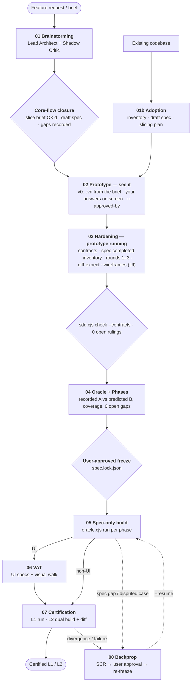

# SDD ICM Workspace Template

> **Release Version:** `2026.10.21-v3.5-prototype-first` (Updated October 21, 2026)

A portable, agent-agnostic workspace template that enforces the **Spec-Driven Development (SDD)** pipeline through filesystem structure and a small set of zero-dependency tools, so that independent coding agents built from the same spec produce **observationally equivalent** systems — and so that claim can be checked.

Based on the [Interpretable Context Methodology (ICM)](https://arxiv.org/html/2603.16021) paper's principle: _"If the context is interpretable, the agent is steerable."_

## Quick Start

1. **Copy** the template contents into your project root:
   ```bash
   cp -r /path/to/skills/icm-workspace-template/{.cursorrules,CLAUDE.md,AGENTS.md,specs} /path/to/your-project/
   ```
   `CLAUDE.md`, `AGENTS.md` and `.cursorrules` are identical copies of `specs/.sdd/_config/entrypoint.md`. If your project already has one of these files, append the entrypoint's content instead of overwriting it.

2. **Requirements:** Node.js ≥ 18 for the tools (`specs/.sdd/scripts/*.cjs`, no `npm install`). Playwright only for UI projects.

3. **Open** the project in your AI-assisted editor (Claude Code, Codex, Cursor, Gemini, …) and ask your agent to start. It reads its entry file, runs `node specs/.sdd/scripts/sdd.cjs status`, and begins at Stage 01 (or 01b for an existing codebase). Expect a short interview, one slice brief to OK, and a running prototype before any contract or test is written.

No global rules. No plugin install.

### Upgrading an existing project

```bash
node /path/to/skills/icm-workspace-template/specs/.sdd/scripts/sdd.cjs upgrade --from /path/to/skills/icm-workspace-template --root /path/to/your-project
```

It replaces `specs/.sdd/` with the newer template, keeps the state file (mapping an older pipeline's stage names to today's numbering, e.g. an accepted `03p_prototype` becomes Stage 02 complete), renames the log files whose names changed between versions, regenerates the entry files when they are still the template's copy (a customized one is left alone with a note), and writes `specs/logs/upgrade-<version>.md` with the status and readiness output and two sections for the agent to fill: where the project stands per slice, and the next actions. The pipeline is one entry of the lock (`pipeline: { version, hash }`), so on a locked project the upgrade leaves a one-line diff — `sdd.cjs verify` prints `pipeline 2026.10.20-v3.4 → 2026.10.21-v3.5`, no file list — and the upgrade log says so. The re-freeze is still the user's call:

```bash
node specs/.sdd/scripts/sdd.cjs freeze --reason "upgrade: 2026.10.21-v3.5-prototype-first" --approved-by "<user>"
```

A lock written before the pin existed (every pipeline file hashed one by one) reads as "pipeline unpinned" until that re-freeze. Release history and open items: [`Future_work.md`](Future_work.md).

## The Core Mission: Observational Equivalence

The fundamental failure mode of AI-assisted engineering is **the ambiguity gap**: a prose specification leaves choices open — error formats, null vs absent fields, ordering, rounding, which error wins when two apply — and two independent agents (or two runs of one agent) fill them differently. Both claim success; their systems are incompatible.

SDD v3 defines equivalence operationally:

> **Two builds are observationally equivalent iff, for every case and probe in `specs/fixtures/`, they produce identical observations at the declared interfaces, after masking only the values the spec explicitly declares variable** (SPEC §9 Equivalence Boundary: server-generated ids, timestamps, cursor values, free-text error details).

Equivalence is therefore relative to the oracle and its probes — the stronger the oracle, the stronger the claim — and it is *measured*:

| Level | Evidence |
|---|---|
| **L1 Oracle-conformant** | Frozen set intact + `oracle.cjs run` 100% green against the current lock |
| **L2 Equivalence-verified** (default target) | L1 + a second build made from the frozen set alone, in a fresh agent session, and `oracle.cjs diff` (and `diff-ui` for UIs) reporting zero divergences between the two |

Every divergence `diff` finds is an unconstrained degree of freedom the spec forgot to pin. It goes back into the spec (Stage 00), not into the code.

### Diff early: measuring divergence before code exists

Most divergences start as ambiguous spec text, so v3 measures them at every stage, cheapest first:

| Stage | Diff | Catches |
|---|---|---|
| 02 | Every demo answer and feedback change edits the spec in the same step as the code; `check --spec` keeps the draft well-formed | Drift between what the user saw and what the spec says, while it is one line |
| 03 | `check --contracts` (schemas, cross-references, spec structure, §11 ↔ manifest, operations named); prototype Decision Inventory (every observable choice cites the spec or becomes a `GAPS.md` row); Red Team rounds 1–3 with an **executed** Fork Test against the running prototype; sampled `diff-expect` by two spec-only authors (≥ one case per operation/command, gated) | Gaps a real builder hits, found against a product the user already accepted |
| 04 | Two interpretations: A recorded from the accepted prototype, B predicted from the spec alone, `diff-expect` (gated); profile-generic cases generated, not hand-written; `gen-probes` widens the measured surface | Remaining ambiguity; places where the prototype decided what the spec did not |
| 05 | Builder's decision inventory per phase; optional lockstep build B with `diff --phase N` | Gaps while little code depends on them |
| 07 | Full dual-build `diff` / `diff-ui` (gated for L2; per slice, or per release with `equivalenceCadence: "release"`) | The evidence |

A predicting author writes `{"$unspecified": "…"}` where the spec does not decide a value; agreement without citations counts as a gap, because two identical guesses are still guesses. A value backed only by a `recorded:` citation ("the prototype did it") is also a gap.

### See it, then harden it

v2 felt right to use: a short conversation, a theme chosen in the browser, one design OK, then something to look at. v3 produced specs complete enough to measure equivalence, but demanded all of that completeness before anything ran. v3.4 keeps both by splitting the pipeline at the running prototype:

**See it (Stages 01–02, the v2 experience):**
- **Stage 01 asks only what the prototype cannot be built without** — actor, primary entity and lifecycle, the core flow, what is forbidden — within a budget (12 questions, `manifest.budgets`) and an audit log (`specs/logs/01-interview.md`). Every other question is a `specs/GAPS.md` row with a provisional assumption. It scopes a bounded slice (30–80 observable outcomes; cap 150), picks the theme (UI), and ends on **one slice brief** the user OKs. The spec it writes is a **draft**: §0, §1, §3, §4, §5 (and §14 for UI) filled, the rest `TBD — Stage 03` (`sdd.cjs check --spec` reports the draft; placeholders are not errors yet). No dual-interpretation sub-agents, no four-dimension closure gate, no section-by-section design approvals before the user has seen anything.
- **Stage 02 builds the prototype from the brief** — every project type, against a one-page [prototype checklist](specs/.sdd/_config/references/prototype-checklist.md) (the dozen profile rules that are expensive to retrofit). Every demo is a numbered **version** (budget 3) where the user answers the open policy questions with the product on screen; feedback edits the spec in the same step as the code. The stage ends when the user accepts on the command line (`transition --completed 02 --approved-by "<user>"`, recorded in `transitions.jsonl`, never typed into a file by the agent). No contracts, Red Team or oracle exist yet.

**Harden it (Stages 03–04, the v3 completeness, with the prototype running):**
- **Stage 03 compiles the contracts against the prototype** (the Reconciler reads the code; spec pins X and the code does Y → fix the code; spec silent → gap, never "the prototype already does it"), completes every spec section (`check` errors on placeholders from here on), inventories the prototype's decisions, runs **all Red Team rounds with the prototype running** (round 1 full with the four Extraction Closure dimensions, rounds 2–3 delta, cap 3, the Fork Tester executes the request instead of imagining the answer), proves the spec readable with a sampled `diff-expect` by two spec-only authors, and — for UI projects — captures the frozen wireframes from the prototype's screens (`ui-capture.cjs`) and has the user review them. The user is asked only the policy questions a round raises, batched, at a demo.
- **Stage 04 records instead of re-deriving** — build A's observations are recorded, an independent spec-only author predicts them, and `diff-expect` turns every disagreement into a spec fix. Stage 04 refuses to finish while any gap is `open`.
- **Stage 05 loops on the oracle, per phase** — Decision Inventory, build, `oracle.cjs run --phase N` until green, then one Red Team pass for what the oracle cannot see.
- **`sdd.cjs dashboard` is the same map as a page.** `specs/logs/dashboard.html` is rewritten at every transition and on demand; it shows nothing the commands do not print, so it can be shared with people who never open a terminal.
- **`sdd.cjs readiness` is the user's map** at every point — budgets against actuals, their open policy questions verbatim with the provisional answers, the stages left before a frozen spec in plain words, and the single next action that is theirs; counts, never a score.
- **Iterations keep the old oracle as a guard** — on the next slice, Stage 02 prototypes on the certified build A, and every existing case must stay green through Stages 02 and 03 unless a decision-log entry names it as a declared behavior change.
- **L2 cadence is a choice** — `manifest.json#equivalenceCadence: "release"` lets intermediate slices certify L1 with an explicit `L2 pending` row and a lockstep diff as early warning; L2 is certified with `transition --completed 07 --release` before a release. The default stays L2 on every slice.

The guarantee is unchanged: L2 still requires a build B made from the frozen set alone, an L1 certificate on a prototype-derived build says so, and a pending slice is never called L2.

### Reference example

[`specs/.sdd/_config/examples/notes-service/`](specs/.sdd/_config/examples/notes-service/) is a complete frozen spec set — SPEC, decision log, contracts, 55 derived cases plus 100 generated probes — validated against an independent reference implementation (55/55 green, zero divergences between two instances over all 155 cases, and every deliberately broken variant caught). Agents imitate examples more reliably than they follow rules.

**Contracts parse the same everywhere.** OpenAPI YAML is always read by the bundled `yaml-lite` parser, which rejects plain scalars that YAML 1.1 and 1.2 tools read differently (`yes`/`no`/`on`/`off`, `1_000`, `0755`, unquoted dates) — quote them — so the contract means the same thing to the tools and to every builder's YAML library.

### The Six Laws of SDD v3

1. **Zero unconstrained degrees of freedom — outside a declared boundary.** Every business decision is made with the user in Stages 01–02. What may legitimately vary is listed explicitly (SPEC §9); everything else is pinned.
2. **Pinned defaults for plumbing.** The [Equivalence Profile](specs/.sdd/_config/references/systems-standards.md) fixes the choices where builders typically diverge — error envelope (RFC 9457), status codes and error precedence, timestamps, ids, null handling, pagination, idempotency, concurrency, string normalization. Deviations are explicit overrides tied to a decision-log entry.
3. **Machine contracts over prose — and machine-checked.** Operations, storage, lifecycles and errors live in `specs/contracts/`; `sdd.cjs check` validates them against [JSON Schemas](specs/.sdd/_config/schemas/) and each other.
4. **One grader, never the builder.** The oracle is data (`specs/fixtures/`), written in Stage 04 before the graded build, and executed by the shipped, implementation-agnostic `oracle.cjs`. No stage writes its own grader. Expected values must be *derivable* from the spec (`derivedFrom`); a value the oracle author had to invent — or could only copy from the prototype — is a spec gap.
5. **The spec is the only channel.** The Stage 02 prototype (and its Stage 03 hardening fixes) is the only pre-freeze code and is never evidence. Stage 05 builders use only the frozen set — no conversation history, no swarm logs, no other implementation (build A may read its own prototype code; build B never sees it). Whatever they would have to guess is raised as a spec gap instead.
6. **Change control with a lock.** `sdd.cjs freeze` hashes the frozen set into `specs/spec.lock.json` after user approval. After that, frozen files change only through a Class 1 iteration or a Stage 00 Spec Change Request, each ending in a user-approved re-freeze. `sdd.cjs verify` detects anything else, and gates refuse to advance on a broken lock.

## Tooling

All tools are zero-dependency Node.js scripts in `specs/.sdd/scripts/`.

| Command | Purpose |
|---|---|
| `sdd.cjs status` | Current stage, lock state, latest evidence, and the next stage's exit gates |
| `sdd.cjs check [--contracts \| --spec]` | Validate manifest, contracts, the spec's structure (required sections, placeholders, hedged numbers, §11 ↔ manifest overrides, every operation named, UI components ↔ DESIGN.md, module links, size), oracle cases, cross-references, coverage (every operation × status, transition, illegal transition, invariant, error code; exemptions by class) and phase binding. `--spec` checks the Stage 01–02 draft alone: placeholders and unfilled sections are reported, not errors, and the sections a prototype needs are listed |
| `sdd.cjs readiness` | Report only (exit 0): slice size vs cap, gaps by kind, budgets vs actuals (interview questions, prototype versions, Red Team rounds), the user's open policy questions verbatim, coverage, latest diff-expect, the path to a frozen spec with the user's next action, failing gates for 01/02/03/04 |
| `sdd.cjs agenda [--write]` | The questions only people outside the pipeline can answer: open policy gaps and every `[PENDING-<ROLE>]` decision, grouped by role (`--write` → `specs/logs/agenda.md`). An answer is a new row whose text says `supersedes DECnnn`; the superseded row then drops off the agenda, the readiness count and the dashboard |
| `sdd.cjs metrics` | One row per transition with its recorded metrics (questions, versions, rounds, gaps, outcomes, cases): where the time went, comparable across slices |
| `sdd.cjs spec-outline` | Size of every SPEC section and module, to plan the split into `specs/spec/<module>.md` |
| `sdd.cjs dashboard [--out F] [--json] [--open]` | One self-contained HTML page (no scripts, no network) with the pipeline strip, the next stage and the user's next action, exit gates, budgets, settings, gaps and questions, the agenda, lock/check/oracle evidence, prototype versions and the transition history; `specs/logs/dashboard.html` by default, rewritten by every transition; `--json` emits the same data for other tools |
| `sdd.cjs upgrade --from <template-root>` | Replace `specs/.sdd` with a newer template: state file kept, legacy logs renamed, entry files regenerated, `specs/logs/upgrade-<version>.md` written with the status and readiness output |
| `sdd.cjs freeze --reason R --approved-by U` | Lock the frozen set (refused unless `check` passes) |
| `sdd.cjs verify` | Exit 1 if any frozen file changed since the last freeze |
| `sdd.cjs transition --completed <stage> [--approved-by U] [--release]` | Record a completed stage — refused if out of order (unless `--override DECnnn`) or until that stage's exit gates pass. 02 requires `--approved-by` (the user's acceptance of the prototype); 07 with cadence `release` requires `--release` to certify L2 |
| `sdd.cjs export <dir> [--update]` | Copy only the frozen set into `<dir>` for an independent (L2) build; `--update` resyncs it after a re-freeze, keeping B's code and progress |
| `oracle.cjs run [--phase N]` | Grade a build: HTTP, SQL and CLI steps with matchers, captures and templates |
| `oracle.cjs diff --a a --b b` | Run the same cases and probes against two builds; report every undeclared difference |
| `oracle.cjs diff-ui --a A.jsonl --b B.jsonl --b-root DIR` | Compare two builds' UI observations (ARIA snapshots + test ids from `ui-observe.cjs`) |
| `oracle.cjs gen-probes` | Derive edge-case probes from the OpenAPI contract (boundaries, nulls, Unicode, content types, idempotency, preconditions, pagination, routing) |
| `oracle.cjs diff-expect --a A --b B` | Interpretation diff: compare two independently written expectation sets; every disagreement, `$unspecified` or uncited case is a spec gap |
| `oracle.cjs strip-expect --from A --out DIR` | Request-only skeletons with neutral titles for an independent second author |
| `oracle.cjs env` | Print the frozen build environment every graded build is started with |
| `oracle.cjs record --target T --out F` | Fill expectations from observed behavior: record interpretation A from the accepted, hardened prototype (Stage 04; for an adopted codebase this is its characterization oracle) |
| `ui-capture.cjs --url U --name N [--aria]` | Capture one rendered screen state of the prototype as a static wireframe (styles inlined, scripts stripped, test ids kept) plus its capture record (Stage 03, needs Playwright) |
| `ui-specgen.cjs` | Generate one UI smoke spec per captured screen state from the capture records (Stage 04): navigate as captured, assert every recorded test id, observe for `diff-ui` |
| `start-server.sh` / `stop-server.sh` | Visual Companion for brainstorming and live wireframes |

## Why ICM?

### The Problem with Global Skills

Traditional AI agent workflows rely on global configuration (`~/.gemini/config/skills/`, global `CLAUDE.md` rules, editor-specific rule files). This creates three problems:

1. **Not portable.** Share a project with a teammate? They need your exact skill setup.
2. **Not auditable.** The instructions controlling code generation live outside the repo — invisible to code review.
3. **Not versioned.** Skills evolve, but deployed projects don't track which version they were built with.

### The ICM Solution

ICM moves the orchestration logic **into the project's filesystem**. The agent discovers the pipeline by reading `WORKSPACE_ROUTING.md`; each stage's `CONTEXT.md` is a self-contained contract declaring Inputs, Process, Outputs and exit gates. The pipeline files are themselves part of the frozen set, so a project records — and locks — the exact pipeline version it was built with.

| Layer | What it does | Where it lives |
|-------|-------------|----------------|
| **Layer 0: Identity** | Workspace and pipeline version | HTML comments in `WORKSPACE_ROUTING.md` |
| **Layer 1: Routing** | Entry protocol, change classes, stage map | `WORKSPACE_ROUTING.md` |
| **Layer 2: Stage Contracts** | Detailed instructions per stage | `NN_stage_name/CONTEXT.md` |
| **Layer 3: Reference Material** | Profile, schemas, templates, checklists — loaded on demand | `_config/` |
| **Layer 4: Working Artifacts** | Spec, contracts, oracle, logs | `specs/` root |

**Token efficiency.** The agent reads `WORKSPACE_ROUTING.md` (~80 lines) to route, then only the relevant stage's `CONTEXT.md`; heavy references load only when a stage asks for them. Stage contracts use a compressed notation (`!` = must, `⊥` = forbidden, `∀` = for all, …) with a decoder line in each file.

## The Pipeline



| Stage | Purpose | Exit gate (`sdd.cjs transition`) |
|-------|---------|------|
| `00_backprop` | Classify defect → Spec Change Request → approval → patch spec/contracts/oracle → re-freeze | Lock intact, backprop log, `--resume` target |
| `01_brainstorming` | Short interview within a budget; slice scoped; one slice brief OK'd; draft spec with the core sections filled, the rest recorded as gaps with provisional assumptions | Draft sections (§0, §1, §3, §4, §5, UI §14) filled, DECISION_LOG, (DESIGN), interview log, GAPS.md well-formed (open rows and placeholders allowed) |
| `01b_adoption` | Inventory an existing codebase, draft the spec of what it does today, plan the slices to harden; the existing system is the Stage 02 prototype and Stage 04 records its characterization oracle | Same draft gate as 01, incl. the interview log |
| `02_prototype` | Working prototype of the slice built from the brief (every project type), shown as numbered versions; the user answers the open policy gaps on screen and accepts | Run line + ≥ 1 version row, `--approved-by`, valid GAPS.md, (iterations) old oracle green or declared |
| `03_hardening` | Contracts compiled against the prototype; spec completed; Decision Inventory; Red Team rounds 1–3 with the prototype running; sampled diff-expect; wireframes captured from the prototype (UI) | `check --contracts` with a complete spec, slice ≤ cap, Outcome Table matching the contracts, fresh inventory, ≥ 1 round and no open ruling, sampled diff-expect, (UI) wireframes + relative-linked DESIGN.md section |
| `04_writing_implementation_phases` | Oracle synthesis (recorded A vs predicted B), phases, user-approved freeze | Full `check`, zero open gaps, generated cases green on the prototype, lock intact |
| `05_development_swarm` | Spec-only build, per phase: inventory → build → oracle until green → one Red Team pass (A continues the prototype) | Lock intact, current unfiltered oracle run green, zero drift |
| `06_visual_acceptance_testing` | Frozen UI specs + visual walk (UI only) | VAT verdict PASS |
| `07_verification_before_completion` | Fresh evidence; L1/L2 certification; deferred gaps listed for the next slice | Fresh green run, equivalence report, (L2) zero-divergence diff — or `L2 pending` row under cadence `release` |

## Change Classes

| Class | Definition | Route |
|---|---|---|
| **0 Non-observable** | Refactor, dependency bump, performance, internal logging | 05 → 07; oracle must stay 100% green, lock unchanged |
| **1 Observable** | Feature, behavior change, new error, UI change, the next slice | 01 → 02 → 03 → 04 (re-freeze) → 05 → (06) → 07 |
| **2 Defect** | Disputed case, `diff` divergence, escaped bug | 00 → re-freeze → resume |

- **Starting from an existing spec document (PRD, design doc, an earlier pipeline's `SPEC.md`):** with no code behind it, Stage 01 treats it as the brief: decisions carried into the log, draft written from it, only the open core-flow questions asked, hardening redone in Stage 03 against the prototype. With working code behind it, Stage 01b: the code describes today, the document is evidence of intent, and every disagreement between them is a gap row for the walkthrough. A project already on this pipeline with a lock is upgraded in place.
- **Adding a feature / next slice (Class 1):** Stage 01 starts from the `deferred` rows of `GAPS.md`; prototype the change on build A in Stage 02 (the old oracle must stay green except for declared behavior changes), extend the contracts and harden in Stage 03, add cases and a new phase in Stage 04 (existing cases may only change where a decision-log entry declares the behavior change), re-freeze with approval, build the new phase. `--phase N` runs are cumulative, so old behavior keeps being re-graded.
- **Fixing a bug (Class 2):** Stage 00 decides whether the code broke the spec (→ Stage 05) or the spec allowed the bug (→ pin it, add a case that fails on the buggy build, re-freeze, → Stage 05).
- **Refactoring (Class 0):** no spec work at all — the frozen oracle proves the refactor changed nothing observable.

## Directory Structure

```
icm-workspace-template/
├── CLAUDE.md · AGENTS.md · .cursorrules   ← identical entry points (from _config/entrypoint.md)
├── README.md
└── specs/
    ├── .gitignore                          ← ignores Visual Companion sessions
    └── .sdd/                               ← pipeline machinery (frozen with the spec)
        ├── WORKSPACE_ROUTING.md
        ├── 00_backprop/ 01_brainstorming/ 01b_adoption/ 02_prototype/ 03_hardening/
        │   04_writing_implementation_phases/ 05_development_swarm/
        │   06_visual_acceptance_testing/ 07_verification_before_completion/   ← one CONTEXT.md each
        ├── scripts/                        ← sdd.cjs, oracle.cjs, sdd-lib.cjs, probes.cjs, yaml-lite.cjs, ui-capture.cjs, ui-specgen.cjs, ui-observe.cjs, Visual Companion
        └── _config/
            ├── references/                 ← Equivalence Profile, prototype checklist, oracle standard, Red Team, closure
            ├── schemas/                    ← JSON Schemas for manifest, errors, statecharts, oracle
            ├── contract-matrix.json        ← required contracts per project type
            ├── canonical-errors.json       ← profile error codes (machine-checked)
            ├── spec-template.md · design-template.md · gaps-template.md · rulings-template.md · prototype-record-template.md · …
            └── sdd-state.json.template
```

After running the pipeline, a project also has:

```
specs/
├── SPEC.md                    ← hardened spec (spec-template.md structure)      [frozen]
├── spec/<module>.md           ← optional spec modules, each linked from SPEC.md [frozen]
├── DESIGN.md                  ← design tokens (UI)                               [frozen]
├── contracts/                 ← manifest.json, openapi.yaml, schema.sql, statecharts.json, errors.json, …   [frozen]
├── fixtures/                  ← oracle.config.json, cases/*.json, seed/, ui/*.spec.ts   [frozen]
├── wireframes/                ← approved HTML wireframes (UI)                    [frozen]
├── spec.lock.json             ← lock manifest (hashes, approvals, history)
├── DECISION_LOG.md · IMPLEMENTATION_PHASES.md · GAPS.md · backprop-log.md
├── changes/SCR-*.md           ← Spec Change Requests
├── logs/                      ← 01-interview, 02-prototype, 03-swarm/-rulings/-decisions, agenda.md, dashboard.html, oracle/diff reports, transitions.jsonl (+ decisions.fingerprint.json), upgrade-<version>.md, VAT screenshots
├── dev-swarm-reconciliation.md · VAT_REPORT.md · EQUIVALENCE_REPORT.md
└── .sdd/_config/sdd-state.json ← pipeline pointer (written by `sdd.cjs transition`)
```

`sdd-state.json` is a small pointer (`lastCompletedStep`, `stepName`, `projectType`, `timestamp`, `notes`); everything else lives in the lock and logs (the user's prototype acceptance and per-stage metrics are recorded in `specs/logs/transitions.jsonl`). The stages are linear, so the pointer is unambiguous. Only `sdd.cjs transition` writes the state, so the exit gates are never bypassed.

### Tests

`node --test tests/*.test.cjs` exercises the pipeline state machine black-box (stage order including the rolling cadence, Stage 00 resume, slice cap, swarm rounds, draft spec checks, prototype acceptance, hardening gates, adoption gates, iteration regression guard, equivalence cadence, invariant credit from citations, the append-only decision log, agenda, metrics, spec outline, UI spec generation, template upgrade, SPEC size warning). The `tests/` directory lives outside `specs/` so projects created from the template do not copy it; CI runs it together with `sdd.cjs check` on the reference example and the entry-file parity check.

## What Changed in v3

v3 challenges several v2 decisions that worked against the equivalence goal:

| v2 | v3 | Why |
|---|---|---|
| Builders "forbidden" to edit `specs/`, but told to update SPEC.md on minor drift | Lock + `verify`; drift → fix code or SCR; SPEC never edited to match code | The builder rewriting the spec is self-grading |
| Fixtures as free-form JSON; harness written by whoever | Schema'd cases executed by a shipped grader | Whoever writes the harness decides how strict grading is |
| Backprop edits spec, tests and code without approval | SCR + user approval + discrimination check; no code in Stage 00 | Backprop was a way around the lock |
| "≥ 3 iterations, iteration 1 always fails" | Objective exit criteria (`check`, Outcome Table, sampled diff-expect); fork-only blocking findings; hard cap 3 rounds | Forced failures produce manufactured findings; "until zero findings" never converges |
| State written, never read | `status` + gated `transition` | Gates that nothing checks are suggestions |
| Equivalence asserted ("bisimulation proof") | Measured: L2 dual build + `oracle diff` | The claim needs evidence |
| Plumbing left to "industry standard" | Equivalence Profile with rule ids | "Standard" differs between builders |
| Error envelope labelled RFC 9457 but non-compliant; three codes for OCC conflicts | RFC 9457 problem details; one canonical code table | A self-contradictory standard forks builders |
| Pinned directory layout and dependencies | Pinned *observable* environment; internals free | Layout is not observable; DB collation is |

## Operating playbook

What experience with real projects says about running the pipeline well:

- **Slice small.** A first slice of 30–80 declared outcomes reaches a running prototype after a 6–10 question interview. The cap of 150 is a ceiling, not a target; `sdd.cjs readiness` shows the count.
- **Five user touchpoints per slice**, and only those: the Stage 01 interview (one question per message, within the budget) and its one-message slice brief, the Stage 02 demos (each a version; the open policy questions are answered there, one per message) ending in `--approved-by`, the policy questions Stage 03's rounds raise (batched; UI projects also review the captured screens), the Stage 04 freeze approval, and the Stage 07 report. Stage 03 and Stage 05 otherwise run without the user. `sdd.cjs readiness` names the next action that is the user's at every point.
- **Spend model strength where judgment is needed**: the Red Team critics, the spec-only predictor B (Stages 03 and 04) and the Stage 05 Decision Inventory. Generation (prototype code, contract drafts, build A phases) tolerates cheaper models. Build B should use a different model family than build A when available: two readings of the spec from the same model share its biases.
- **Budget by stage, in counts.** Every transition records `metrics` in `specs/logs/transitions.jsonl` (rounds, gaps, rulings, outcomes, cases); compare them across projects to see where time goes before changing the pipeline.
- **Keep the spec readable in one pass.** `check` warns above 120 KB per file and `sdd.cjs spec-outline` shows where the bytes are; Stage 03 splits by surface into `specs/spec/<module>.md` with `SPEC.md` as the index (every module linked), and keeps tables in the contracts.
- **The decision log is append-only, and the tool knows.** Every transition fingerprints the rows; `check` and `status` warn when an earlier row changes. Derived artifacts cite decisions by id.
- **Derived artifacts.** A complete spec set generates traditional deliverables mechanically: the `design-package` skill (systems-engineering package, with a review loop back into the spec) and the `spec-deliverables` skill (API reference, user manual, test plan; markdown plus one compiled HTML page each) live in the skills repository next to this template. Both stamp the lock they were built from and report when they fall behind it; neither ever edits `specs/`. Run them after every freeze, and the test plan after every oracle run.
- **Cadence is a decision.** `prototypeCadence: "rolling"` lets several slices be prototyped before one hardening pass; hardening then runs in slice-sized passes in acceptance order, and the cap is enforced at Stage 03 per accepted slice (each `transition --completed 02` records the slice's declared outcomes in `transitions.jsonl`; `readiness` and the dashboard show one size per slice), never for their sum. Default is L2 on every slice; teams shipping several slices before a release set `equivalenceCadence: "release"`, keep the lockstep build B green, and certify L2 once with `--release`. A pending slice is never called L2.

## Relationship to the SDD skills

The template is the single source of the pipeline. The earlier global skills (`../brainstorming`, `../adversarial-swarm-analysis`, …) are not maintained against it: the oracle, lock, Equivalence Profile, prototype stage and gated transitions exist only here, and every project runs the workflow through these files. `../scripts/validate-icm-sync.sh` remains for anyone comparing the two.

## Version

Check the version header in `specs/.sdd/WORKSPACE_ROUTING.md`:
```html
<!-- sdd-icm-template -->
<!-- version: 2026.10.21-v3.5-prototype-first -->
<!-- source: github.com/Wilberto-lopez-skymantics/skills -->
```

The lock (`specs/spec.lock.json`) pins the pipeline a project was built with as one entry — its version and one hash over every file under `specs/.sdd/` — next to the per-file hashes of the spec content; upgrading the template is a frozen-set change and requires a re-freeze (`freeze --reason "upgrade: <version>"`), whose diff is that one line.
